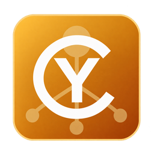
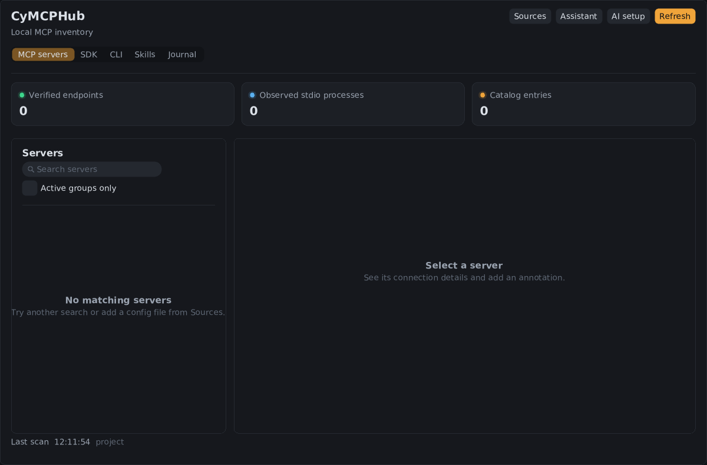

<table width="100%">
  <tr>
    <td width="300" align="left" valign="top">
      <a href="Documentation/Documentation.html#/fr/welcome">Manuel hors ligne</a> 
      <a href="https://github.com/MrMybal/CyMCPHub">Dépôt</a> 
      <a href="https://github.com/MrMybal/CyMCPHub/issues">Signaler un problème</a>  
      README 
      <a href="README.md">English</a> · <a href="README.fr.md">Français</a>
    </td>
    <td width="400" align="center" valign="middle">
      
    </td>
    <td width="300" align="right" valign="top">
      
Licence de l’application <a href="LICENSE"><strong>GPL-3.0-only</strong></a>

      
Version <a href="VERSION.fr.md"><strong>0.3.3</strong></a>

      
<strong>Windows x64 · Linux x64</strong> Cible de compilation macOS

    </td>
  </tr>
</table>

<h1 align="center">CyMCPHub</h1>

Un explorateur de bureau pour les serveurs MCP locaux, les SDK et les CLI d’IA, avec un catalogue d’outils consultable et un assistant contextuel. Le Hub retrouve les connexions et partage le catalogue avec un autre client IA.

Les [notes de version](VERSION.fr.md) décrivent les plateformes et les limites actuelles.

## Ce que vous pouvez faire

- **Inspecter un connecteur.** Regroupez les serveurs par nom, choisissez une source et un transport, consultez les données de connexion et ajoutez une annotation. Chargez ses outils et ressources, exécutez une action avec des arguments JSON et consultez le journal.
- **Analyser les logiciels locaux.** Choisissez un fichier ou un dossier pour rechercher des marqueurs CyMCPSDK et des CLI connues. Collectez les fichiers `SKILL.md` trouvés dans les analyses ou exposés par un connecteur.
- **Travailler avec l’assistant.** Ouvrez le chat dans une fenêtre séparée qui suit l’onglet actif. Connectez un fournisseur pris en charge, attachez un connecteur et rédigez un Skill pour celui-ci.
- **Partager le catalogue.** Connectez un client en stdio ou en HTTP Streamable local. `mcp_catalog` recherche les applications et leurs outils et peut renvoyer du Markdown.

---

## Lancer CyMCPHub

| Plateforme | Lancement depuis le paquet natif |
| --- | --- |
| Windows x64 | Lancez l’installateur ou ouvrez `CyMCPHub.exe` depuis une version portable. Gardez `CyMCPHubMcp.exe` à côté en mode portable. Les builds liés au runtime partagé Microsoft Visual C++ nécessitent le redistribuable x64. |
| Ubuntu 24.04 x64 | Installez `libcurl4t64`, puis lancez `./CyMCPHub` à côté de `CyMCPHubMcp`. L’icône de notification nécessite un bureau compatible AppIndicator et le paquet `libayatana-appindicator3-1`. |
| macOS 14+ · Intel et Apple Silicon | Le workflow de compilation prévoit une cible universelle `CyMCPHub.app`. La compilation et la validation sur un bureau macOS restent à faire. |

Ouvrez [Documentation.html](Documentation/Documentation.html#/fr/welcome) dans votre navigateur depuis le projet ou le paquet extrait. Gardez le dossier `DocData` à côté. Dans le Hub, **Connexion IA** génère la configuration client et permet d’activer le service HTTP en arrière-plan.

L’installateur Windows s’installe pour le compte courant et crée un raccourci dans le menu Démarrer. Le démarrage à l’ouverture de session est coché par défaut à la première installation. Les mises à jour respectent ce choix, modifiable dans **Réglages**. Dans l’app, **Mises à jour → Rechercher une mise à jour** consulte la dernière release stable sur GitHub. Sous Windows x64, si un installateur compatible est disponible, téléchargez-le puis choisissez **Quitter et installer**. Le Hub vérifie la taille et le SHA-256 fournis par GitHub avant de lancer l’installation. [Guide des mises à jour](Documentation/Documentation.html#/fr/desktop/updates).

## Connecter un client IA

La page **Réglages**, dans la barre latérale, regroupe les sources d’inventaire, l’intervalle d’actualisation des MCP et la configuration à copier dans un client IA. Par défaut, l’inventaire se relance toutes les minutes, y compris quand la fenêtre est masquée dans la zone de notification. Le service HTTP local propose un port configurable et un mode d’accès avec ou sans jeton. L’option **Démarrer avec l’application** du service et **Démarrer avec Windows** sont deux réglages indépendants.

1. Dans **Sources**, choisissez le projet et ajoutez sa configuration MCP si nécessaire.
2. Ouvrez **Connexion IA**. Choisissez **stdio** pour laisser le client lancer le serveur MCP du Hub, ou activez **Service MCP (HTTP)** pour utiliser l’application de bureau en cours d’exécution.
3. Copiez la configuration vers votre client. Appelez `mcp_list` pour retrouver l’identifiant du connecteur, puis `mcp_tools` avec cet identifiant pour consulter les schémas. Utilisez `mcp_catalog` avec `format: "markdown"` pour obtenir une synthèse des applications.

Le manuel hors ligne propose un [exemple MCP](Documentation/Documentation.html#/fr/mcp/tools-example) et des [étapes de dépannage](Documentation/Documentation.html#/fr/troubleshooting/inventory) quand un connecteur manque ou que le chargement des outils échoue.

## Compiler les sources

Voir les [commandes de compilation et de paquetage en local](BUILD.md). La chaîne utilise CMake 3.24+, un compilateur C++20, Git et Python 3 pour les tests d’intégration. Node.js 22+ permet de régénérer le manuel. Le dépôt contient aussi un [workflow de paquetage manuel](https://github.com/MrMybal/CyMCPHub/blob/main/.github/workflows/native-packages.yml).

---

## Licence

CyMCPHub est distribué sous la [licence publique générale GNU, version 3 uniquement](LICENSE) (`GPL-3.0-only`).

### Licences des dépendances

Les paquets natifs contiennent les notices de leurs composants.

| Composant | Licence | Utilisation |
| --- | --- | --- |
| [CyUI](https://github.com/MrMybal/CyUI) et Dear ImGui | MIT | Interface et composants natifs |
| [CyMCPSDK](https://github.com/MrMybal/CyMCPSDK), nlohmann/json, cpp-httplib, PicoSHA2 et toml++ | MIT | MCP, assistant, JSON, HTTP et configuration |
| MD4C | MIT | Rendu Markdown |
| Lexilla et Scintilla | [Licence Lexilla/Scintilla](https://www.scintilla.org/License.txt) | Vues texte et code |
| JetBrains Mono | SIL Open Font License 1.1 | Police d’interface |
| [SDL3](https://github.com/libsdl-org/SDL) | zlib | Fenêtres, rendu et zone de notification sous Linux et macOS |
| [CyDoc](https://github.com/MrMybal/CyDoc) | [MIT](Documentation/DocData/CyDoc.LICENSE.txt) | Générateur de documentation et lecteur hors ligne |
