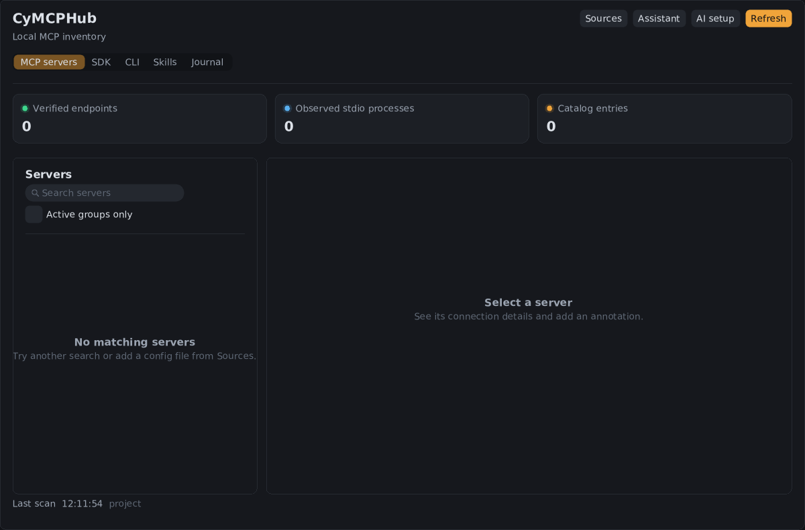

<table width="100%">
  <tr>
    <td width="300" align="left" valign="top">
      <a href="Documentation/Documentation.html#/en/welcome">Offline manual</a> 
      <a href="https://github.com/MrMybal/CyMCPHub">Repository</a> 
      <a href="https://github.com/MrMybal/CyMCPHub/issues">Report an issue</a>  
      README 
      <a href="README.md">English</a> · <a href="README.fr.md">Français</a>
    </td>
    <td width="400" align="center" valign="middle"></td>
    <td width="300" align="right" valign="top">
      
Version <a href="VERSION.md"><strong>0.3.0</strong></a>

      
<strong>Windows x64 · Linux x64</strong> macOS build target

    </td>
  </tr>
</table>

<h1 align="center">CyMCPHub</h1>

A desktop explorer for local Model Context Protocol servers, SDKs and AI command-line tools. Use the Hub to find connections and share a searchable tool catalogue with another AI client.

Read the [version notes](VERSION.md) for platform coverage and current limits.

## What you can do

- **Inspect a connector.** Group servers by name, select a source and transport, read its connection details and add an annotation. Load its tools and resources, run an action with JSON arguments and check the journal.
- **Scan local software.** Select a file or directory to find CyMCPSDK markers and known CLIs. Collect any `SKILL.md` files found in scans or exposed by a connector.
- **Work in the assistant.** Open the chat in a separate window that follows the active tab. Connect a supported provider, attach a connector and draft a Skill for it.
- **Share the catalogue.** Connect a client through stdio or local Streamable HTTP. `mcp_catalog` searches the applications and their tools and can return Markdown.

---

## Run CyMCPHub

| Platform | Launch from the native package |
| --- | --- |
| Windows x64 | Open `CyMCPHub.exe`. Keep `CyMCPHubMcp.exe` beside it. The Microsoft Visual C++ x64 runtime is required. |
| Ubuntu 24.04 x64 | Install `libcurl4t64`, then run `./CyMCPHub` beside `CyMCPHubMcp`. The tray requires an AppIndicator-compatible desktop and `libayatana-appindicator3-1`. |
| macOS 14+ · Intel and Apple Silicon | The universal `CyMCPHub.app` target is available in the build workflow. A macOS build and desktop validation are pending. |

Open [Documentation.html](Documentation/Documentation.html#/en/welcome) from the unpacked project or package in a browser. Keep the `DocData` folder alongside it. **AI setup** in the Hub generates the client configuration and enables the background HTTP service.

## Build from source

See the [build commands](BUILD.md) and the [Native packages workflow](.github/workflows/native-packages.yml). The toolchain uses CMake 3.24+, a C++20 compiler, Git and Python 3 for the integration tests. Node.js 22+ regenerates the manual.

---

## Dependency licences

The native packages include the notices for their bundled components.

| Component | Licence | Purpose |
| --- | --- | --- |
| [CyUI](https://github.com/MrMybal/CyUI) and Dear ImGui | MIT | Interface and native widgets |
| [CyMCPSDK](https://github.com/MrMybal/CyMCPSDK), nlohmann/json, cpp-httplib, PicoSHA2 and toml++ | MIT | MCP, assistant, JSON, HTTP and configuration |
| MD4C | MIT | Markdown rendering |
| Lexilla and Scintilla | [Lexilla/Scintilla licence](https://www.scintilla.org/License.txt) | Text and code views |
| JetBrains Mono | SIL Open Font License 1.1 | Interface font |
| [SDL3](https://github.com/libsdl-org/SDL) | zlib | Linux and macOS windows, renderer and tray |
| [CyDoc](https://github.com/MrMybal/CyDoc) | [MIT](Documentation/DocData/CyDoc.LICENSE.txt) | Documentation generator and offline reader |
